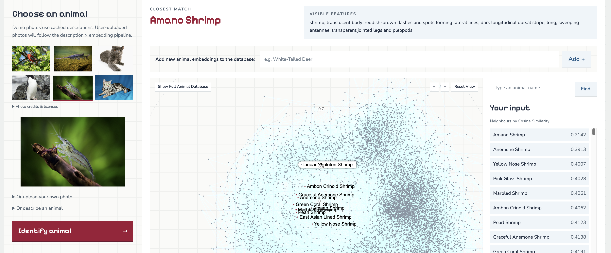

<div align="center">

# FaunaDex

### semantic species retrieval on animal photos by matching visual descriptions with a vector search. currently supports 9,641 species, 4.7x more than Google SpeciesNet's 2,066.

</div>

<div align="center">
<div style="display: flex; justify-content: center; align-items: center;">
    
</div>
</div>

<div align="center">

**[try the demo here !](https://faunadex.andrewd.ai/)**
<br>
**[visit the Hugging Face dataset !](https://huggingface.co/datasets/PenguinPush/animals-massive)**
</div>


### how it works

- `backend/app/image_recognizer.py` sends photos to Gemini for observations about the animal's features.
- `backend/app/semantic_search.py` embeds the animal's features with OpenAI's `text-embedding-3-large`, then ranks locally against normalized animal vectors using NumPy (cosine similarity). descriptions from Gemini go straight to this step.
- `backend/app/embedding_store.py` keeps names and vectors in SQLite, if an animal not yet part of the database is added, it gets vectorized on the spot and saved here.
- `backend/demo/collection_graph.py` projects the collection into 2D with PCA and connects nearest neighbors.
  - `demo/lib/graph.js` renders the interactive map with Sigma.js and Graphology.

<sup>matches are semantic similarity results, not verified species IDs. the 2D map is a projection of the full embedding space.</sup>

### run locally

the current demo uses Next.js / React / Tailwind and a Flask API. use Node.js 22 and Python 3.14 (matching the Docker images).

```bash
python3 -m venv .venv
source .venv/bin/activate
pip install -r backend/requirements-demo.txt
npm --prefix demo ci
```

create a `.env` in the repository root and add your API keys:

```dotenv
OPENAI_API_KEY=your-openai-key
GEMINI_API_KEY=your-gemini-key
```

the default database is `backend/embeds/animals.sqlite3`; set `EMBEDDING_STORE_PATH` to use another copy. run these from the repository root in separate terminals:

```bash
.venv/bin/python -m backend.demo.app
```

```bash
npm --prefix demo run dev
```

open **http://localhost:3000**. Next.js forwards API requests to Flask on port 5050. set `BACKEND_URL` in `demo/.env.local` before starting or building if the API lives elsewhere. keep provider keys on the Python side.

### development
as a developer, i likely won't be actively maintaining this project myself unless something big happens with it, as it was designed to be a fun one-off hackathon project. however, feel free to contribute or do whatever you like with the code, if there's interest in this project, i might consider returning to it :)
